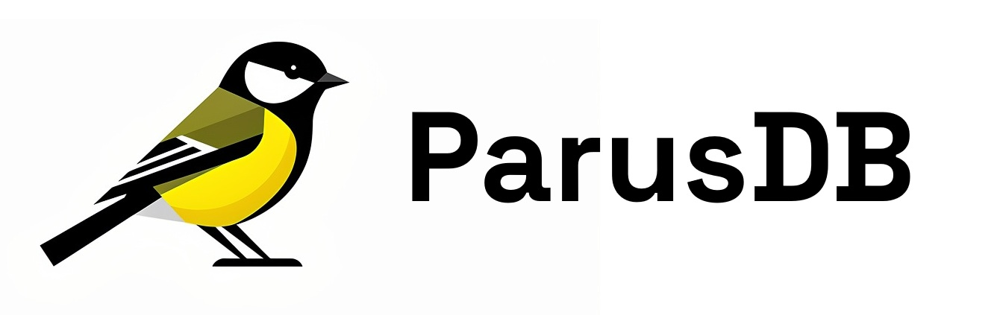

<p align="center">
  
</p>

<p align="center">
  <em>La plateforme Data Analytique IAgentique Open Source — « Vos données, enfin parlantes. »</em>
</p>

[](#licence)
[](https://github.com/ParusDB/parusdb/releases)
[](https://parusdb.com/)

**ParusDB** unifie **ELT**, **Data Lakehouse** et **agents IA** dans une plateforme open
source et souveraine. Déployez-la vous-même, contribuez, ou utilisez-la gratuitement.

Assembler une Modern Data Stack, c'est long, cher, fragile. ParusDB supprime ces barrières :
une plateforme **unifiée** où chaque équipe interroge ses données **en langage naturel** via des
agents IA, où le déploiement se fait **en minutes, pas en mois**, et où vos données ne quittent
**jamais** votre infrastructure.

- **100 % Open Source** sous licence **Apache 2.0** : forkez, contribuez, déployez où
  vous voulez.
- **Auto-hébergement** par défaut : votre serveur, votre cloud, votre local — aucun vendor
  lock-in.
- **Souveraineté totale** : chiffrement au repos et en transit, conforme RGPD, BYO tout
  (S3, LLM, infrastructure).
- **Libre d'utilisation** : aucune redevance, aucune limite. Juste du code, des
  conteneurs, et la liberté de déployer où vous voulez.

## Une plateforme, cinq briques

| Brique | Ce que ça fait |
|---|---|
| **Chat IA** | Interrogation en langage naturel : l'agent choisit le catalogue, écrit le SQL, restitue des chiffres, tableaux et graphiques sourcés — visualisés et exportables. |
| **Agents IA personnalisables** | Pré-instructions, sources associées, LLM au choix par agent : modèles open source exécutés en local (Mistral, Qwen…) ou propriétaires via clé API. Un agent par usage : ventes, support, finance. |
| **Data Lakehouse intégré** | Object Storage S3 (RustFS) + catalogue Iceberg (Apache Polaris) + moteur SQL (Trino). La puissance d'une stack moderne, sans l'assembler. |
| **40+ connecteurs ELT** | Snowflake, PostgreSQL, Salesforce, HubSpot, Notion, Stripe, Shopify, S3… Ingestion incrémentale, ordonnancement CRON, glisser-déposer. Extensibles par la communauté. |
| **RBAC & gouvernance** | Modèle à grants calqué sur Apache Polaris : rôles multiples, rôle actif, droits Lecture/Écriture/Gestion par catalogue, agent et pipeline. Comptes applicatifs dédiés pour les outils data (dbt, Power BI, Airbyte…) — jamais le compte root. |

Brique transversale : le tout est **open source, auditable et transparent** (licence
Apache 2.0).

## Stack technique

| Couche | Technologie | Rôle |
|---|---|---|
| **Frontend** | Next.js (App Router) · TypeScript · Tailwind CSS · shadcn/ui | Interface réactive, typage de bout en bout |
| **Backend** | Supabase (PostgreSQL), self-hosted | Auth, utilisateurs, RBAC, données transactionnelles |
| **Data Lakehouse** | RustFS S3 (Supabase) · Apache Polaris · Trino | Stockage objet, catalogue Iceberg, requêtage SQL fédéré |
| **Chat IA** | Ollama · mcp-trino (Model Context Protocol) | LLM en local, interrogation Trino via MCP |
| **ELT** | dlt (data load tool) | Pipelines d'ingestion génériques et variabilisés |
| **Temps réel** | Supabase Realtime | Streaming des conversations chat |

## Architecture

```
┌──────────────────────────────────────────────────────────────┐
│                      Sources de données                      │
│     PostgreSQL · Salesforce · Stripe · S3 · fichiers · …     │
└──────────────────────────────┬───────────────────────────────┘
                               │ ELT — dlt (incrémental, CRON)
                               ▼
┌──────────────────────────────────────────────────────────────┐
│                        Data Lakehouse                        │
│    RustFS S3 (stockage objet) · Apache Polaris (catalogue    │
│             Iceberg) · Trino (moteur SQL fédéré)             │
└──────────────▲──────────────────────────────▲────────────────┘
               │ SQL                          │ SQL via mcp-trino
               │                              │
┌──────────────┴─────────────┐    ┌───────────┴────────────────┐
│     Interface Next.js      │    │         Agents IA          │
│  éditeur SQL · chat        │◄──►│  Ollama (local) ou LLM     │
│  connecteurs · admin       │    │  propriétaires via clé API │
└─────────┬─────────────────┘    └───────────────────────────┘
          │
          ▼
┌──────────────────────────────────────────────────────────────┐
│             Supabase — PostgreSQL (self-hosted)              │
│         Auth · RBAC · rôles actifs · config agents,          │
│                pipelines, serveurs (S3, LLM)                 │
└──────────────────────────────────────────────────────────────┘
```

## Démarrage rapide

**Prérequis** : Git, Node.js LTS + npm, Docker avec le plugin Compose.

> Le plus simple : `sh setup.sh` à la racine orchestre toute l'installation
> (ordre des dépendances, SQL applicatif, synchronisation du frontend, test
> dlt). Le pas-à-pas ci-dessous détaille chaque brique pour comprendre la
> mécanique.

### 1. Stack Supabase (self-hosted)

```bash
cd apps/supabase
cp .env.example .env
sh utils/generate-keys.sh --update-env        # mots de passe + clés API
sh utils/add-new-auth-keys.sh --update-env    # clés publishable/secret
sh run.sh config add rustfs                   # backend S3 (RustFS) du storage
sh run.sh config add rustfs-restart            # override ParusDB : RustFS redémarre après un reboot
sh run.sh start                               # docker compose up -d --wait
```

Les URLs et ports des services (Studio, API, Auth…) sont définis dans
`apps/supabase/.env`. Guide complet : [`apps/supabase/README.md`](apps/supabase/README.md)
et la [documentation self-hosting Supabase](https://supabase.com/docs/guides/self-hosting/docker).

> L'override `docker-compose.rustfs-restart.yml` (fichier ParusDB) est indispensable :
> le service `rustfs` du vendor n'a pas de politique de redémarrage, et sans lui tout le
> lakehouse — ainsi que le storage Supabase — reste silencieusement cassé après un reboot
> de la machine. À enregistrer sur chaque installation via `sh run.sh config add rustfs-restart`.

### 2. Data Lakehouse (Apache Polaris + Trino)

```bash
cd apps/polaris
sh setup.sh        # base `polaris` dans le Postgres Supabase, bucket RustFS, stack, catalogues `parusdb` (système) + `dev`
cd ../trino
sh setup.sh        # bindings Trino (Iceberg REST), durcissement (HTTPS 8453 + comptes de service), test de bout en bout
```

Polaris persiste ses métadonnées dans le **Postgres de la stack Supabase** (base dédiée
`polaris`) et stocke les fichiers Iceberg dans son **RustFS** — aucun service de données
supplémentaire n'est démarré. Trino est durci : HTTPS avec certificat autosigné +
authentification par mot de passe, règles d'access control générées depuis les droits RBAC.
Détails et pièges d'intégration :
[`apps/polaris/README.md`](apps/polaris/README.md) ·
[`apps/trino/README.md`](apps/trino/README.md).

### 3. Frontend Next.js

```bash
cd apps/nextjs
npm install
cp .env.example .env.local
# Renseigner NEXT_PUBLIC_SUPABASE_URL et NEXT_PUBLIC_SUPABASE_PUBLISHABLE_KEY
npm run dev   # http://localhost:3000
```

La clé publishable est générée à l'étape précédente (`SUPABASE_PUBLISHABLE_KEY` dans
`apps/supabase/.env`).

### 4. Moteur ELT (dlt) — optionnel, pour le menu « Connecteurs »

```bash
cd apps/dlt
sh setup.sh       # rôle parus_dlt, image du runner (45 sources), ordonnanceur
sh run.sh verify  # runner + Postgres applicatif + catalogue Polaris
```

Prérequis : stacks Supabase et Polaris démarrées. Un **conteneur jetable par
exécution** charge les sources (SQL, REST, object store, 29 sources verified)
vers le lakehouse en table format Iceberg ; CRON inclus. Pour une validation
rapide avec une source PostgreSQL bidon :
`docker compose -f demo/docker-compose.yml up -d --wait` puis créez un
pipeline de type PostgreSQL dans l'interface. Détails :
[`apps/dlt/README.md`](apps/dlt/README.md).

> **Parcours recommandé** : `sh setup.sh` à la racine orchestre toute
> l'installation (ordre des dépendances, SQL applicatif, synchronisation du
> frontend, vérification dlt) — l'instance est prête en quelques minutes. Au
> premier lancement, l'interface guide la création du compte **Administrateur**
> (onboarding), aucune commande supplémentaire. Les briques optionnelles
> (Ollama pour le chat en local, dlt pour les connecteurs) se posent ensuite
> selon vos besoins.

## État du projet

La version **1.0.0** est publiée : toutes les briques produit sont fonctionnelles.

- [x] **Socle** — Next.js (App Router) + Supabase self-hosted, auth fonctionnelle
- [x] **Data Lakehouse** — catalogues, schémas, explorateur, éditeur SQL
- [x] **Chat IA** — agents, Ollama, mcp-trino, conversations, streaming
- [x] **Interface frontend** — menus, RBAC, administration
- [x] **RBAC à grants & durcissement** — rôles multiples + rôle actif, comptes
      applicatifs pour les outils data, Trino HTTPS + authentification + access
      control générés depuis les droits
- [x] **Flux ELT** — dlt, 40+ connecteurs, pipelines, CRON

## Structure du dépôt

```
parusdb/
├── AGENTS.md             # Règles de développement pour agents IA et contributeurs
├── README.md             # Ce fichier
├── setup.sh              # Première installation : orchestre les apps dans l'ordre des dépendances
├── run.sh                # Cycle de vie de toute la stack : start/stop/restart/status/logs
├── reset.sh              # Désinstallation complète (destructif)
├── CONTRIBUTING.md       # Guide de contribution
├── SECURITY.md           # Politique de sécurité (divulgation responsable)
├── CODE_OF_CONDUCT.md    # Code de conduite
├── CHANGELOG.md          # Journal des versions
├── docs/functional/      # Fiche produit, spécifications fonctionnelles, charte graphique, logo
├── docs/technical/       # Documentation technique (CI, pipeline d'intégration)
├── .agents/skills/       # Skills Supabase officiels (guides de contribution assistée par IA)
├── .github/              # CI (lint, typecheck, build), scan de secrets, templates d'issues/PR
├── apps/nextjs/          # Application Next.js 16 (App Router) — frontend + BFF
├── apps/dlt/             # dlt — moteur ELT (pipelines → lakehouse, conteneur jetable par run)
├── apps/mcp-trino/       # mcp-trino — serveur MCP exposant Trino aux LLM (lecture seule)
├── apps/ollama/          # Ollama — serveur d'inférence LLM local (GPU)
├── apps/polaris/         # Apache Polaris — catalogue Iceberg (Postgres + RustFS Supabase)
├── apps/supabase/        # Stack Supabase self-hosted (Docker Compose)
└── apps/trino/           # Trino — moteur SQL du lakehouse (Iceberg REST → Polaris)
```

## Documentation

- [Fiche produit](docs/functional/product_page.md) — pitch, positionnement, promesses
- [Spécifications fonctionnelles](docs/functional/functional_specifications.md) — menus,
  fonctionnalités, modèle de données, RBAC, parcours
- [Charte graphique « Mésange Charbonnière »](docs/functional/brand_guidelines.md) — tokens,
  typographie, composants, conformité
- [`apps/nextjs/README.md`](apps/nextjs/README.md) · [`apps/supabase/README.md`](apps/supabase/README.md)
  · [`apps/supabase/CONFIG.md`](apps/supabase/CONFIG.md) — guides techniques des apps
- [`apps/polaris/README.md`](apps/polaris/README.md) · [`apps/trino/README.md`](apps/trino/README.md) —
  guides et pièges d'intégration du Data Lakehouse
- [`apps/dlt/README.md`](apps/dlt/README.md) — architecture, sources et modèle d'exécution
  du moteur ELT (validation e2e incluse)
- [`docs/technical/CI.md`](docs/technical/CI.md) — pipeline d'intégration : jobs, tests,
  validation locale avant d'ouvrir une PR

## Contribuer

Tous les contributeurs sont bienvenus : le guide complet (prérequis, workflow,
conventions, definition of done) vit dans
[`CONTRIBUTING.md`](CONTRIBUTING.md). En résumé :

1. Forkez puis clonez le dépôt.
2. Créez votre branche : `feat/<brique>-<sujet>` (ex. `feat/lakehouse-explorateur`).
3. Développez en suivant [`AGENTS.md`](AGENTS.md) — conventions de code, charte graphique,
   definition of done. Les agents de développement IA doivent le lire en premier.
4. Vérifiez `npm run lint`, `npm run typecheck` et `npm run build` dans
   `apps/nextjs` (la CI les exécute sur chaque PR).
5. Ouvrez une Pull Request décrivant le quoi et le pourquoi.

Pour signaler une vulnérabilité de sécurité : voir [`SECURITY.md`](SECURITY.md)
— jamais d'issue publique pour ce cas.

Questions et discussions : [GitHub Discussions](https://github.com/ParusDB/parusdb/discussions).
Bugs : [Issues](https://github.com/ParusDB/parusdb/issues).
Journal des versions : [`CHANGELOG.md`](CHANGELOG.md).

## Licence

Code source publié sous licence **Apache 2.0** : utilisation, modification et
déploiement libres — y compris à des fins commerciales — sous réserve des
conditions usuelles de la licence (conservation des notices, mention des
modifications, clause de non-contrefaçon de brevets).
Texte intégral : [`LICENSE`](LICENSE). Mentions des composants tiers : [`NOTICE`](NOTICE).

**Marque** : le nom « ParusDB » et son logo sont des marques déposées auprès de
l'INPI. Ils ne sont pas soumis à la licence Apache 2.0 : le nom
et le logo ne peuvent être réutilisés pour nommer un produit ou un service
sans autorisation du mainteneur.

## Liens

- **Site** : <https://parusdb.com/>
- **GitHub** : <https://github.com/ParusDB/parusdb>
- **Documentation, guides** : en construction

### Sites qui ont permis de développer ParusDB

| Technologie | Site / Documentation |
|---|---|
| Next.js | <https://nextjs.org/> |
| Tailwind CSS | <https://tailwindcss.com/> |
| shadcn/ui | <https://ui.shadcn.com/> |
| Supabase (self-hosting, Auth, Realtime) | <https://supabase.com/> · <https://supabase.com/docs/guides/self-hosting> |
| PostgreSQL | <https://www.postgresql.org/> |
| Apache Polaris | <https://polaris.apache.org/> |
| Trino | <https://trino.io/> |
| Apache Iceberg | <https://iceberg.apache.org/> |
| RustFS | <https://rustfs.com/> |
| dlt (data load tool) | <https://dlthub.com/> |
| Ollama | <https://ollama.com/> |
| Model Context Protocol (MCP) | <https://modelcontextprotocol.io/> |
| mcp-trino (Tuan Nguyen) | <https://github.com/tuannvm/mcp-trino> |
| Docker | <https://docs.docker.com/> |
